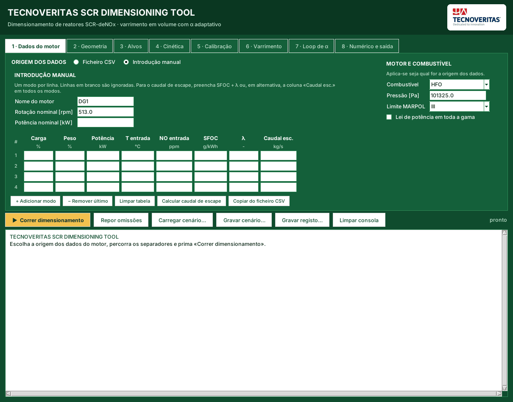
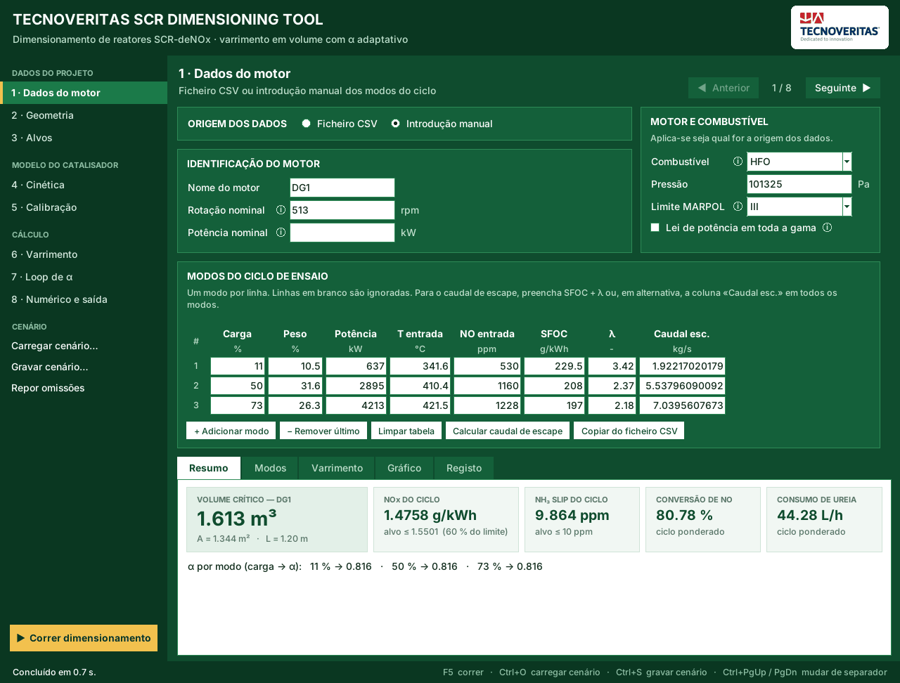
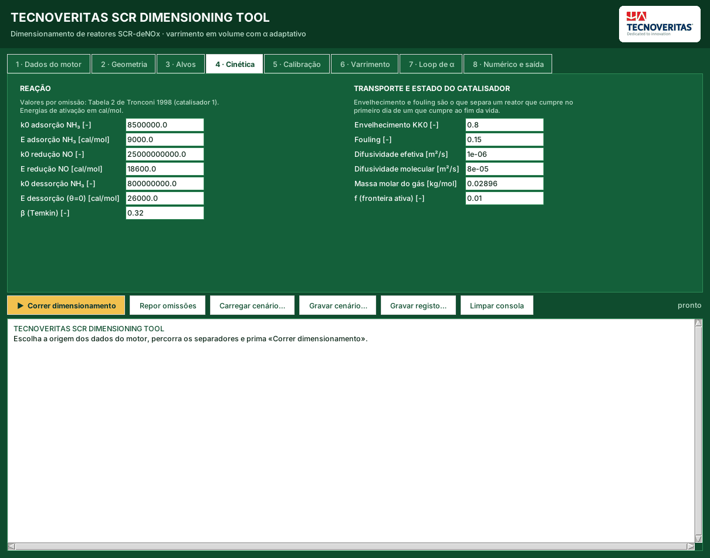
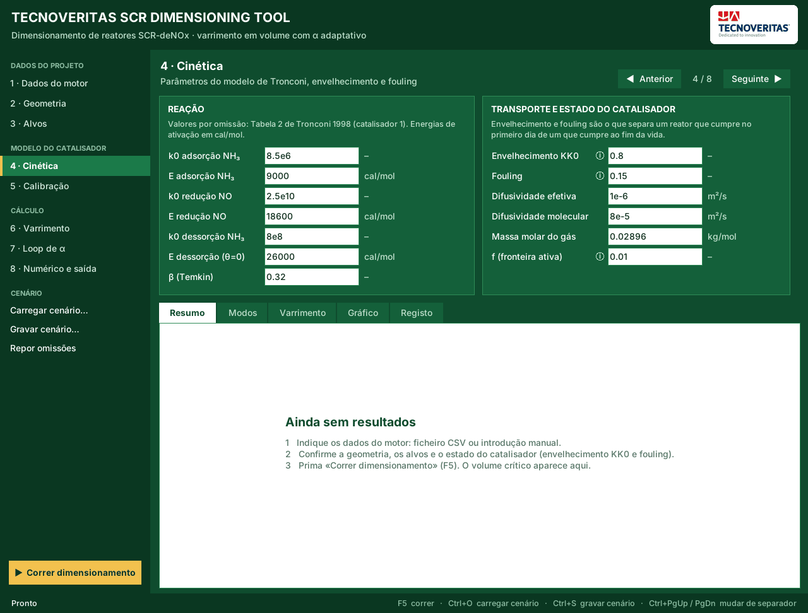
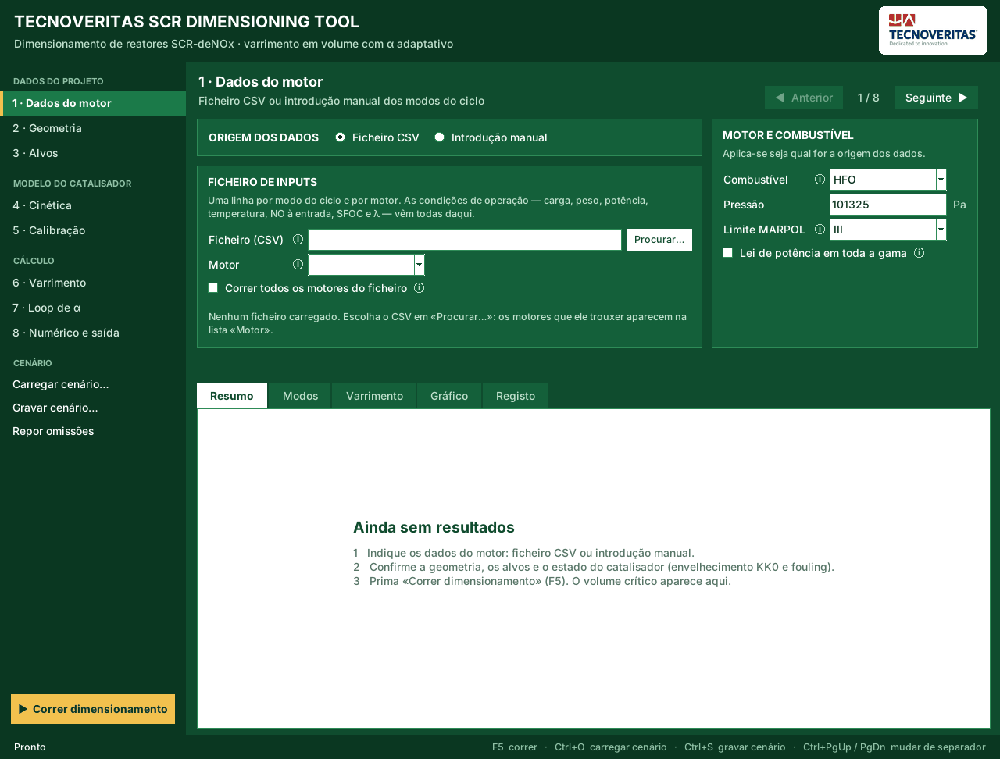
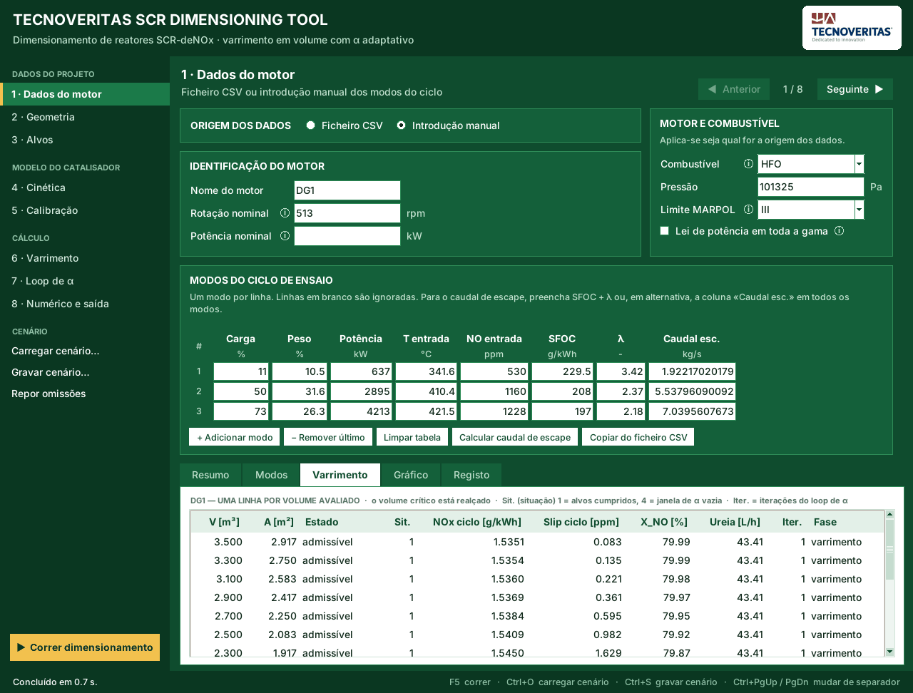
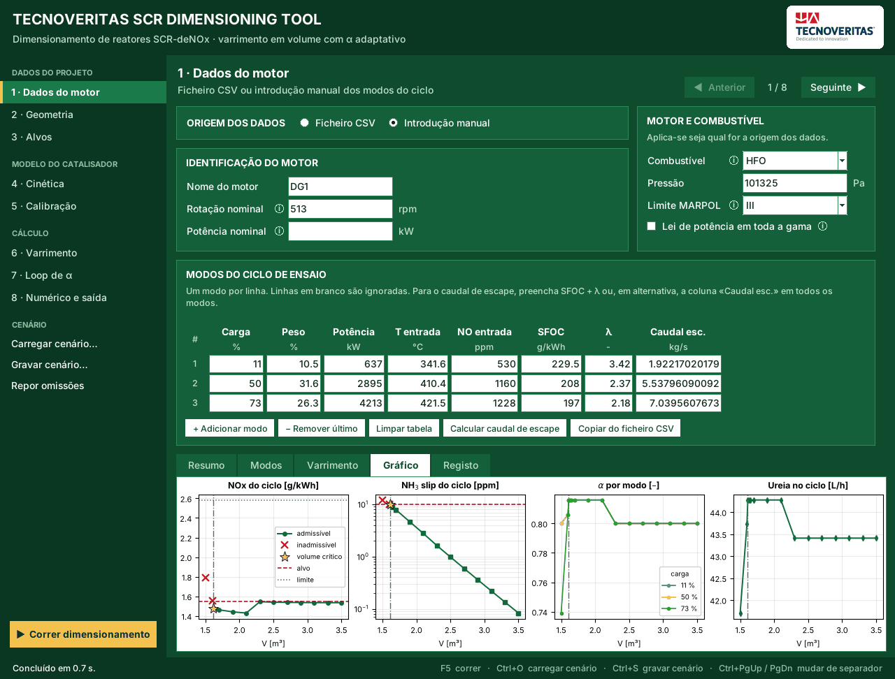
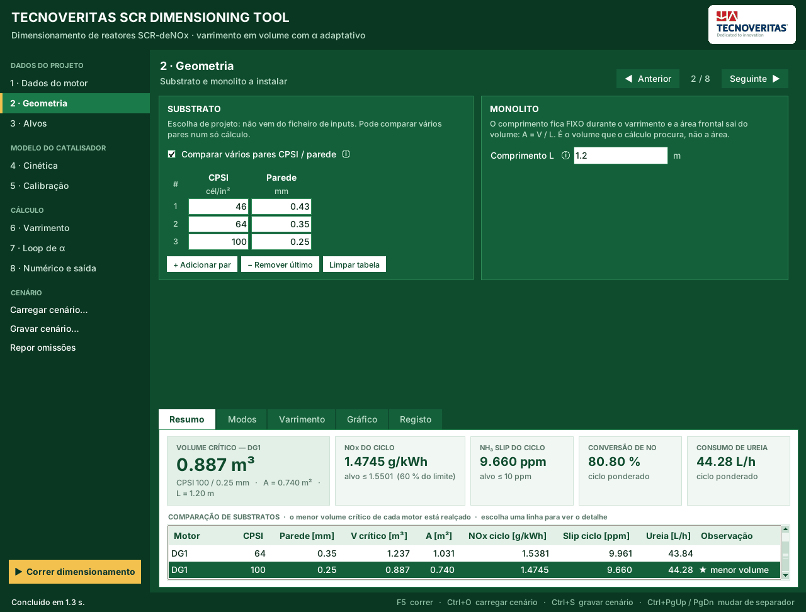
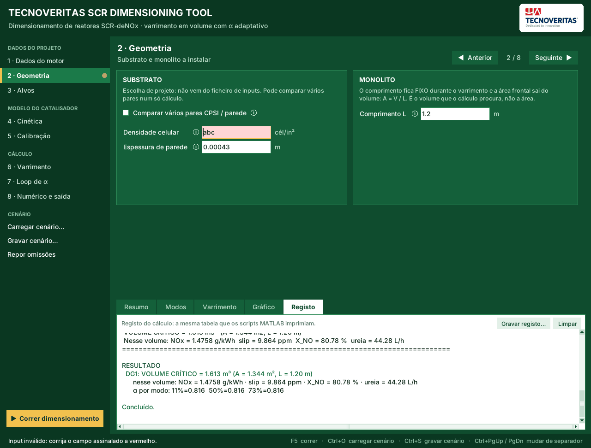

# Alterações ao layout da interface

Registo das alterações feitas à janela da aplicação (`tvscr_ui`) para a tornar
mais fácil de usar. O guia de utilização atualizado está em
[INSTRUCOES.md](INSTRUCOES.md) (§4 «O ecrã» e §7 «Ler os resultados»).

---

## 1. Âmbito

- **Só a interface mudou.** O pacote de cálculo `tvscr` não foi tocado: o
  solver, o loop de α, o varrimento e a paridade com o MATLAB ficam exatamente
  como estavam.
- O contrato entre a interface e a biblioteca é o mesmo: a janela monta um
  `RunScenario` e chama `run()` / `run_one()` / `run_substrate_sweep()`. Os
  cenários `.json` gravados antes continuam a carregar.
- Os ficheiros escritos em disco (CSV e PNG) são os mesmos, com os mesmos nomes.
- Nenhum parâmetro foi acrescentado, retirado ou mudado de separador; os oito
  separadores mantêm o nome, o número e a ordem. Os valores por omissão são os
  mesmos.
- Não há dependências novas. O gráfico embutido usa o `matplotlib`, que já era
  opcional; sem ele, o separador «Gráfico» diz que falta e o resto funciona.

---

## 2. O que dificultava o uso

| # | problema na versão anterior | consequência |
|---|---|---|
| 1 | Oito separadores horizontais com o mesmo peso | Não se percebia o que é dado do projeto, modelo ou opção numérica |
| 2 | Resultado só em texto monoespaçado, na consola | O volume crítico — o resultado do dimensionamento — tinha de ser procurado no fim do registo |
| 3 | Unidade dentro do rótulo (`Pressão [Pa]`) | Rótulos de comprimento diferente: campos desalinhados dentro da mesma secção |
| 4 | Ajuda só ao passar o rato sobre o rótulo, sem qualquer marca | A ajuda só se descobria por acaso |
| 5 | `25000000000.0`, `800000000.0` | Era preciso contar zeros para ler um pré-exponencial |
| 6 | Valor inválido: a mensagem dizia o nome do campo, mas não abria o separador | O utilizador tinha de procurar o campo pelos oito separadores |
| 7 | Estado do cálculo: só o texto «a correr» | Sem indicação de progresso nem de tempo |
| 8 | Secções sem contorno sobre um painel único | Pouca separação visual entre grupos de campos |
| 9 | Informação do ficheiro carregado só na consola | Longe do sítio onde se escolhe o ficheiro e o motor |
| 10 | Altura do formulário e da consola fixas | Não era possível dar mais espaço a uma ou a outra |
| 11 | Em introdução manual, a tabela dos modos partilhava a largura com outra secção | Pouca folga para as oito colunas |

| antes | depois |
|---|---|
|  |  |
|  |  |

---

## 3. Estrutura nova da janela

```
┌────────────────────────────────────────────────────────────────────────┐
│ título                                                          [logo] │
├─────────────────┬──────────────────────────────────────────────────────┤
│ separadores     │ título da página              [◀ Anterior] n/8 [▶]   │
│ (3 grupos)      │ cartões com os campos                                │
│                 │                                                      │
│ cenário         ├═══════════ divisor arrastável ═══════════════════════┤
│                 │ [Resumo][Modos][Varrimento][Gráfico][Registo]        │
│ [▶ Correr]      │ painel de resultados                                 │
├─────────────────┴──────────────────────────────────────────────────────┤
│ estado · progresso                                 atalhos de teclado  │
└────────────────────────────────────────────────────────────────────────┘
```

Antes: título / separadores / página / barra de botões / consola, empilhados.

---

## 4. Alterações, uma a uma

### 4.1 Separadores na barra lateral, em três grupos

Os oito separadores passaram de uma fila horizontal para uma barra lateral,
agrupados sem mudar de ordem:

| grupo | separadores |
|---|---|
| Dados do projeto | 1 · Dados do motor, 2 · Geometria, 3 · Alvos |
| Modelo do catalisador | 4 · Cinética, 5 · Calibração |
| Cálculo | 6 · Varrimento, 7 · Loop de α, 8 · Numérico e saída |

O separador ativo tem fundo mais claro, texto a negrito e uma marca amarela à
esquerda. A barra lateral não rola com o formulário.

### 4.2 Cabeçalho de página e navegação sequencial

Cada página mostra no topo o seu título e uma linha de descrição (antes só
visível como ajuda do separador). À direita, **◀ Anterior**, a posição (`n / 8`)
e **Seguinte ▶** percorrem as páginas pela ordem. `Ctrl+PgUp` / `Ctrl+PgDn`
fazem o mesmo.

### 4.3 Cartões e grelha de colunas

- Cada secção é agora um **cartão** com contorno, sobre o fundo mais escuro da
  página. Os cartões da mesma linha têm a mesma altura.
- Dentro de um cartão, todos os campos partilham uma grelha de colunas fixas:
  **rótulo | ajuda | campo | unidade**. A unidade saiu do rótulo para uma
  coluna própria, a seguir ao campo; os campos ficam alinhados na vertical.
  Um parâmetro adimensional mostra «–».
- A nota de cada cartão quebra à largura do cartão (antes, a um valor fixo).
- Tipo de letra base de 9 pt para 10 pt; campos ligeiramente mais altos.

### 4.4 Marcador de ajuda

Os parâmetros com explicação têm um **«i» num círculo** entre o rótulo e o
campo. Passar o rato sobre ele (ou sobre o rótulo, como antes) mostra a
explicação. O texto das explicações não mudou. O balão já não sai do ecrã em
campos junto à margem direita.

### 4.5 Apresentação dos números

Os campos mostram notação científica curta fora de `[1e-4, 1e6[` e decimal
simples dentro dessa gama:

| antes | depois |
|---|---|
| `25000000000.0` | `2.5e10` |
| `800000000.0` | `8e8` |
| `101325.0` | `101325` |
| `1e-06` | `1e-6` |
| `0.00043` | `0.00043` |

É só apresentação: o texto parte de `repr`, pelo que o valor lido de volta é
exatamente o mesmo `float` (há um teste que o verifica). Continua a poder
escrever-se em qualquer forma, com ponto ou vírgula decimal.

### 4.6 Página «1 · Dados do motor»

- **Origem dos dados** num cartão próprio, à esquerda; **Motor e combustível**
  à direita, a toda a altura.
- **Ficheiro CSV**: por baixo da escolha do motor aparece o que o ficheiro traz
  para ele — número de modos, limite de NOx, gama de caudais de escape, NO à
  entrada e L sugerido. Com «todos os motores», a lista dos que vão ser
  corridos. (A mesma informação continua a ir para o registo.)
- **Introdução manual**: o cartão do ficheiro dá lugar à identificação do
  motor, e a tabela dos modos passa a ocupar a **largura toda da página**, num
  cartão próprio por baixo. No modo CSV esse cartão não ocupa espaço.
- O botão `...` de escolha de ficheiro/pasta passou a **Procurar…**.



### 4.7 Painel de resultados

A consola deu lugar a um painel com cinco separadores. A consola continua lá,
com o mesmo texto de antes, no separador **Registo**.

| separador | conteúdo |
|---|---|
| **Resumo** | Volume crítico em destaque (com A e L); NOx e slip do ciclo, cada um com o alvo ao lado; conversão de NO; consumo de ureia; α por modo. Com vários resultados, uma tabela que os compara. |
| **Modos** | Ponto de operação de cada modo no volume crítico: α, X_NO, NO, slip, ureia, τ e situação do modo. |
| **Varrimento** | Uma linha por volume avaliado, do maior para o menor; volume crítico realçado, volumes inadmissíveis a vermelho. |
| **Gráfico** | NOx do ciclo, slip (log), α por modo e ureia contra o volume, com alvos e volume crítico. Desenhado à medida do painel e redesenhado quando este muda de tamanho. |
| **Registo** | A consola, com **Gravar registo…** e **Limpar** (que saíram da barra de botões para junto do que afetam). |

Comportamento:

- Antes do primeiro cálculo, o *Resumo* mostra como começar, em três passos.
- Durante o cálculo o painel passa ao *Registo*; no fim, passa ao *Resumo*.
- **Vários resultados** («todos os motores» ou comparação de substratos):
  escolher uma linha da tabela de comparação muda o resultado mostrado em
  todos os separadores. Na comparação de substratos, o par de menor volume
  crítico fica marcado com ★ e escolhido à partida; os pares impossíveis ficam
  a vermelho, com o motivo.
- **Sem volume admissível**: o mosaico do volume fica a vermelho, com «Sem
  solução» e o que fazer; o separador *Modos* mostra o maior volume avaliado,
  para se ver qual o modo em situação 4.
- Texto novo no *Registo* enquanto este está escondido marca o separador com
  um ponto («Registo •»).

Os números mostrados são lidos do `VolumeSweepResult` devolvido pela
biblioteca; o painel não calcula nada.





### 4.8 Divisor arrastável entre inputs e resultados

- A linha entre a página de inputs e o painel de resultados arrasta-se com o
  rato. Duplo clique repõe o ajuste automático.
- **Ajuste automático**: o formulário fica com a altura da página mais alta
  (para o divisor não saltar ao mudar de separador), até um limite que reserva
  espaço aos resultados — pouco enquanto o painel está vazio, mais quando há
  um cálculo a correr ou resultados para ler.
- Só a página ativa ocupa espaço, pelo que uma página alta (a tabela de modos)
  já não obriga as outras a rolar. A barra de rolamento do formulário só
  aparece se a página ativa não couber.

### 4.9 Ações, barra de estado e atalhos

- **▶ Correr dimensionamento** fica sempre visível, ao fundo da barra lateral.
- **Carregar cenário…**, **Gravar cenário…** e **Repor omissões** formam o
  grupo «Cenário» da barra lateral.
- **Barra de estado** ao fundo da janela: estado atual; durante o cálculo, uma
  barra de progresso e o tempo decorrido; no fim, a duração total. Também
  confirma ações (ficheiro carregado, cenário gravado, …).
- **Atalhos**: `F5` ou `Ctrl+Enter` (correr), `Ctrl+O` (carregar cenário),
  `Ctrl+S` (gravar cenário), `Ctrl+PgUp` / `Ctrl+PgDn` (mudar de separador).

### 4.10 Valor inválido: a janela leva o utilizador ao campo

Quando um campo tem um valor inválido ao correr ou ao gravar o cenário, a
aplicação:

1. abre o separador onde o campo está;
2. põe o cursor no campo (que fica a vermelho claro, como antes);
3. assinala o separador com um ponto vermelho na barra lateral;
4. mostra a mensagem de erro, como antes.

A marca é limpa em cada nova tentativa, e reposta se o erro persistir.



### 4.11 Pormenores

- Os botões realçam ao passar o rato (o Tk só o fazia ao premir).
- Barras de rolamento com as cores da aplicação.
- A roda do rato também rola o formulário no Linux (X11).
- Janela: 1280 px de largura por omissão (antes 1210), mínimo 1040 × 640. Em
  ecrãs com menos de 900 px de altura abre maximizada.
- Larguras da barra lateral e das colunas das tabelas medidas no tipo de letra
  em uso, para não cortarem texto com outra fonte ou outra escala de ecrã.

---

## 5. Onde está o que mudou de sítio

| elemento | antes | agora |
|---|---|---|
| Separadores 1 a 8 | Fila horizontal por cima da página | Barra lateral, em três grupos |
| ▶ Correr dimensionamento | Barra de botões, entre a página e a consola | Fundo da barra lateral (`F5`) |
| Carregar / Gravar cenário, Repor omissões | Barra de botões | Barra lateral, grupo «Cenário» |
| Gravar registo…, Limpar consola | Barra de botões | Separador «Registo» do painel de resultados |
| Estado («pronto» / «a correr») | À direita da barra de botões | Barra de estado, ao fundo |
| Consola | Sempre visível, por baixo dos botões | Separador «Registo» |
| Unidade de cada parâmetro | Dentro do rótulo, entre parênteses retos | Coluna própria, a seguir ao campo |
| Tabela dos modos (manual) | Coluna esquerda da página 1 | Cartão a toda a largura, por baixo |

---

## 6. Ficheiros alterados

| ficheiro | alteração |
|---|---|
| `tvscr_ui/theme.py` | Cores da barra lateral, dos botões discretos e da folha de resultados; tipos de letra novos (título de página, indicadores); base a 10 pt |
| `tvscr_ui/widgets.py` | `Section` como cartão com grelha de colunas e `add_block()`; unidade em coluna própria; `HelpMark`; `format_number`; `FieldError` leva o campo em causa; `flat_button` / `ghost_button` com realce; consola com barras de rolamento temáticas e aviso de escrita |
| `tvscr_ui/paged.py` | `PagedForm` com separadores verticais agrupados (`add_group`), cabeçalho de página, Anterior / Seguinte, marca de erro (`flag`), `key_of`, `tallest_height`; só a página ativa na grelha |
| `tvscr_ui/results.py` | **Novo.** `ResultsPanel`: Resumo, Modos, Varrimento, Gráfico e Registo |
| `tvscr_ui/main_window.py` | Montagem da janela (barra lateral, divisor, barra de estado, atalhos); página 1 reorganizada; `_collect_or_report` / `_reveal_error`; ligação ao painel de resultados. A recolha (`_collect`), a aplicação de cenários (`_apply`) e a execução (`_worker`, `_run_*`) mantêm a lógica |
| `tests/test_ui.py` | 37 testes novos (ver §7); os 45 existentes não foram alterados |
| `INSTRUCOES.md` | §4 reescrita; §5, §6, §7, §8, §9 e §10 atualizadas para o novo ecrã |
| `README.md` | Descrição da interface (§4), tabela de módulos (§2) e de testes (§10) |
| `docs/layout/*.png` | Capturas de ecrã usadas neste documento |

---

## 7. Verificação

```bash
python -m pytest tests -q
```

- **115 testes passam**, 29 são ignorados por faltarem os ficheiros de
  referência do MATLAB e o `Tabela_Inputs_Final.csv` (não estão no
  repositório). Antes das alterações: 78 passam, 29 ignorados — os mesmos 29.
- Os 10 testes da interface que dependem do CSV foram corridos à parte com um
  CSV sintético de cinco motores no mesmo formato: passam todos.
- Os testes existentes da interface passam **sem alterações**, incluindo os de
  recolha do `RunScenario`, de ida e volta de cenários e de alinhamento da
  tabela.
- Testes novos: agrupamento dos separadores, navegação, página ativa, colunas
  de unidade, marcador de ajuda, formatação e leitura exata dos números,
  navegação para o campo inválido, conteúdo de cada separador de resultados
  (com um varrimento real), comparação de vários resultados e de substratos,
  caso sem solução, dimensões do gráfico, e o percurso completo do botão ao
  resumo.
- Verificação visual por capturas de ecrã de todas as páginas e de todos os
  separadores de resultados, a 1920 × 1080 e a 1366 × 768, com corridas reais
  (motor manual, CSV com todos os motores, comparação de substratos, caso sem
  solução, valor inválido).

**Limite da verificação.** Tudo foi corrido em Linux (Python 3.12, Tk 8.6, ecrã
virtual). **Não foi testado em Windows**, que é onde a aplicação é usada: a
fonte será a Segoe UI (as capturas deste documento usam a fonte do ambiente de
teste, com métricas ligeiramente diferentes) e a abertura maximizada em ecrãs
baixos só existe nessa plataforma. Convém uma passagem pelos oito separadores e
uma corrida no Windows antes de dar a alteração por fechada.

---

## 8. Notas

Observações feitas durante o trabalho, **não alteradas** por estarem fora do
âmbito do layout:

- **«Repor omissões» não repõe o «Volume máximo».** O cenário por omissão não
  define volume máximo, e `_apply` só escreve o campo quando ele vem definido;
  o valor que estiver no formulário mantém-se. Já era assim.
- **Os `__pycache__/*.pyc` estão versionados**, apesar de constarem do
  `.gitignore` (foram adicionados antes dele). Correr a aplicação ou os testes
  modifica-os. `git rm -r --cached` das pastas `__pycache__` resolve.
- Com várias páginas de alturas diferentes, o formulário reserva a altura da
  mais alta; em páginas curtas sobra espaço verde por baixo dos cartões. É o
  custo de o divisor não saltar ao mudar de separador; arrastá-lo resolve caso
  a caso.
